# 🌸 Clínica Aurora — Smart Web Experience

Site de uma clínica de estética e bem-estar (cliente fictício) com **recomendador de tratamentos**, **catálogo de serviços** e a **Aurora**, uma assistente de atendimento com **IA generativa (Google Gemini via Make)** que leva o cliente até o agendamento no WhatsApp.

Projeto da disciplina **Padrões Web para No Code e Low Code** (UniFECAF) — *Smart Web Experience: Criando uma Experiência Digital com No-Code, Padrões Web e IA*.

## 🔗 Links

| O quê | Link |
|---|---|
| Aplicação publicada | https://clinicaaurora.framer.website/ |
| Código-fonte | https://github.com/brunarcampos/clinica-aurora |

## 🎯 O problema

A clínica divulga seus serviços apenas pelas redes sociais. Quem quer tirar dúvidas, saber preços ou agendar precisa chamar manualmente e esperar a resposta. A empresa não tem equipe de desenvolvimento e precisa de uma solução rápida, de baixo custo e que possa evoluir.

## ✨ Funcionalidades

- **Recomendador de cuidados:** o visitante responde duas perguntas ("Como você quer se sentir hoje?" e "Quanto tempinho você tem?") e recebe até duas indicações de tratamento, cada uma com botão para agendar.
- **Catálogo "Nossos cuidados":** seis serviços com descrição, preço e duração.
- **Assistente Aurora:** chat flutuante com atalhos de pergunta ("Quero relaxar", "Pele com manchas", "Quanto custa?", "Horários") que responde em linguagem natural.
- **Agendamento pelo WhatsApp:** cada serviço gera uma mensagem pronta (por exemplo, "Olá! Quero agendar: Limpeza de pele profunda").
- **Responsivo:** versões para Desktop, Tablet e Phone.
- **Modo escuro** automático, conforme a preferência do dispositivo.

## 🧰 Tecnologias e ferramentas

- **Framer** (plataforma no-code): publicação, domínio e breakpoints (Desktop 1200 px, Tablet 810–1199 px, Phone até 809 px).
- **HTML, CSS e JavaScript puros**, inseridos no Framer pelo componente **Embed (tipo HTML)**.
- **Make** (automação): cenário com webhook que recebe a pergunta do site.
- **Google Gemini** (IA generativa): gera as respostas da Aurora.
- **WhatsApp** (`wa.me`): encaminhamento para o atendimento humano.
- **GitHub**: versionamento do código.

## 🛠️ Personalizações com padrões web

**HTML**
- Estrutura semântica (`header`, `nav`, `main`, `section`, `footer`) e `lang="pt-BR"`.
- Recomendador como `form` com `fieldset` e `legend`; opções com `input type="radio"` dentro de `label`.
- Chat com `role="dialog"`, `aria-expanded`, `aria-controls` e `aria-live`.
- Link "Pular para o conteúdo".

**CSS**
- Variáveis CSS para a paleta rosa e azul, com degradê de fundo (`radial-gradient`).
- Modo escuro com `@media (prefers-color-scheme: dark)`.
- Layout com CSS Grid, tipografia fluida com `clamp()` e sombra colorida com `color-mix()`.
- Opções em formato de "chips" estilizadas com `input:checked + span`.
- `100dvh` e `env(safe-area-inset-*)` para celulares; `prefers-reduced-motion` respeitado.
- Na versão do Framer, o CSS é escopado em `#app` para não conflitar com a plataforma.

**JavaScript**
- Serviços em um array de objetos; a lista é gerada a partir dele.
- Função `recommend()` com pontuação: filtra pelo tempo, ordena pelo peso do objetivo e, em empate, pela menor duração.
- Escape de texto antes de usar `innerHTML` (evita injeção de HTML).
- Chat com `fetch` assíncrono, `AbortController` (limite de 15 s) e plano B local.

## 🤖 Recurso inteligente

A Aurora usa **IA generativa**:

1. O site envia a pergunta do cliente por `GET` ao webhook do Make (`?message=...`).
2. O cenário do Make tem três módulos: **Custom webhook** → **Google Gemini AI** (com um prompt de sistema que define a persona, os serviços, preços, horários e regras de resposta) → **Webhook response**.
3. A resposta em texto volta ao site e aparece no chat.

**Plano B:** se o webhook falhar, demorar ou o cenário estiver desligado, a função `local()` responde por regras e expressões regulares (preço, horário, endereço, agendamento, relaxar, pele, inchaço, sobrancelha). O chat nunca fica sem resposta.

A URL do webhook é configurada em `CONFIG.webhookUrl`, no `script.js`.

## 🧪 Como testar

1. Acesse https://clinicaaurora.framer.website/.
2. **Recomendador:** escolha um objetivo e um tempo e clique em **Ver minha recomendação**. Depois clique em **Agendar no WhatsApp** para ver a mensagem pronta.
3. **Assistente:** clique em **Conversar com a Aurora** e pergunte algo livre, como _"tenho pele sensível, o que você indica?"_. Uma resposta em linguagem natural indica que a IA está funcionando.
4. **Responsividade:** redimensione a janela ou abra no celular.
5. **Acessibilidade:** navegue só pelo teclado (Tab, setas nos chips, Enter; Esc fecha o chat).

Para rodar localmente, baixe o repositório e abra o `index.html` no navegador (os arquivos `style.css` e `script.js` ficam na mesma pasta).

## 📸 Prints

### Site publicado

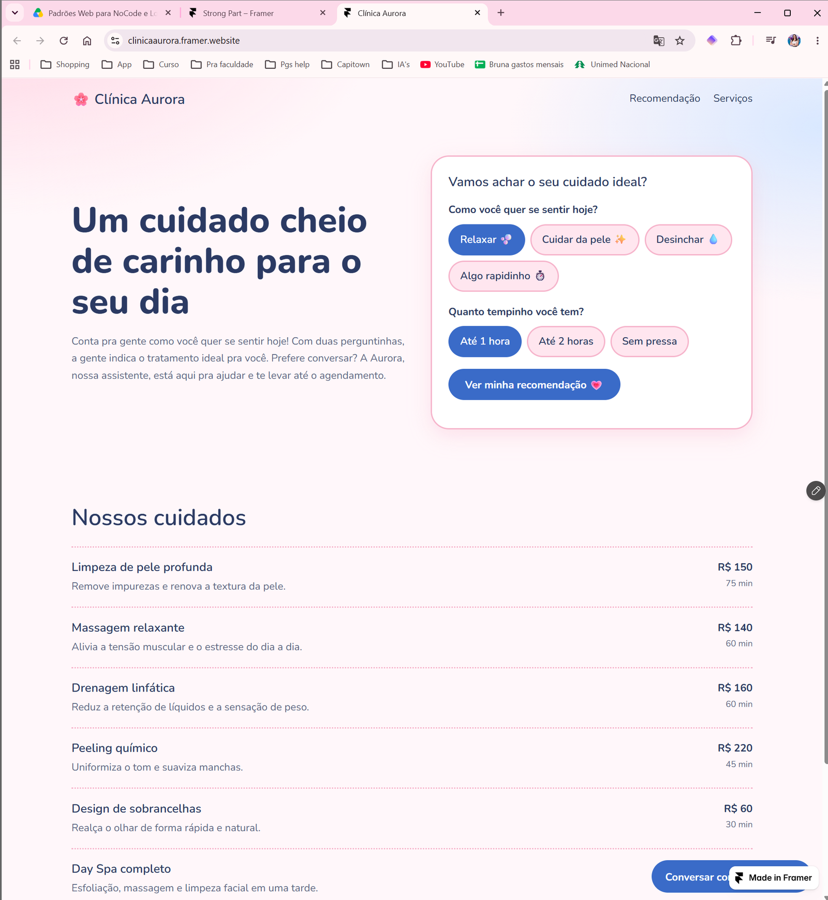

### Desktop

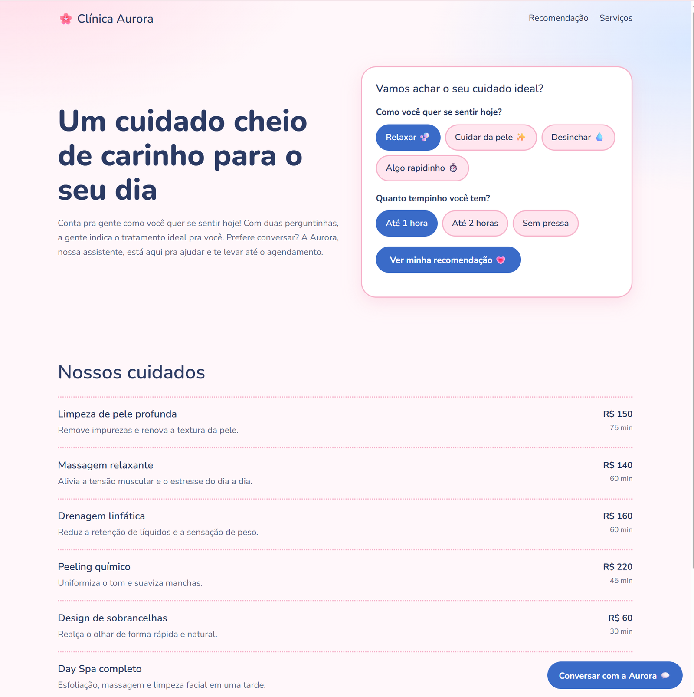

### Tablet

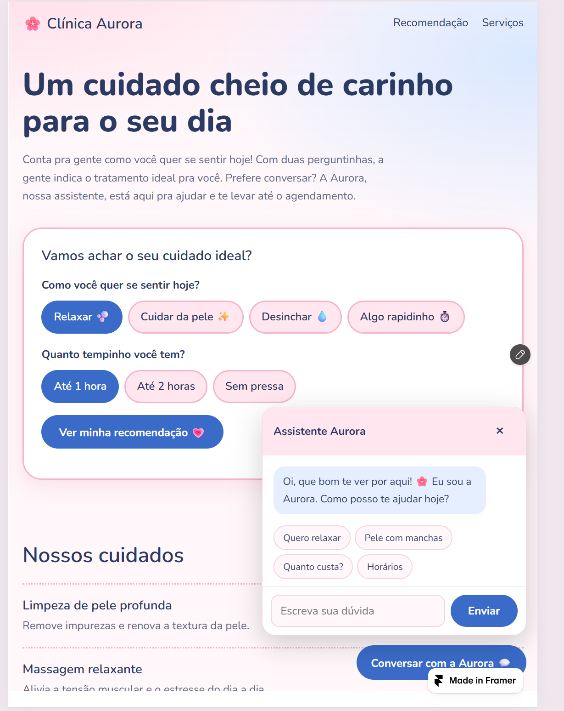

### Phone

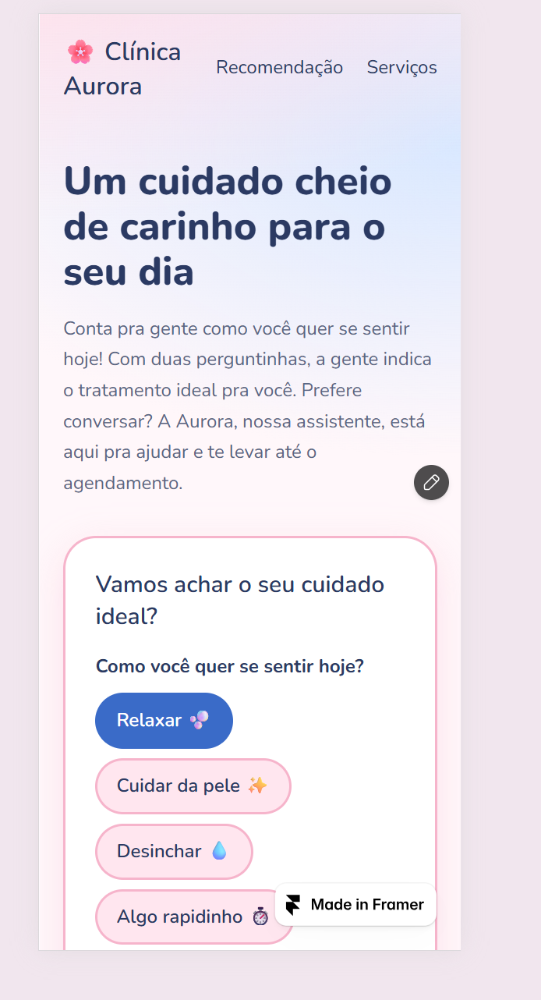 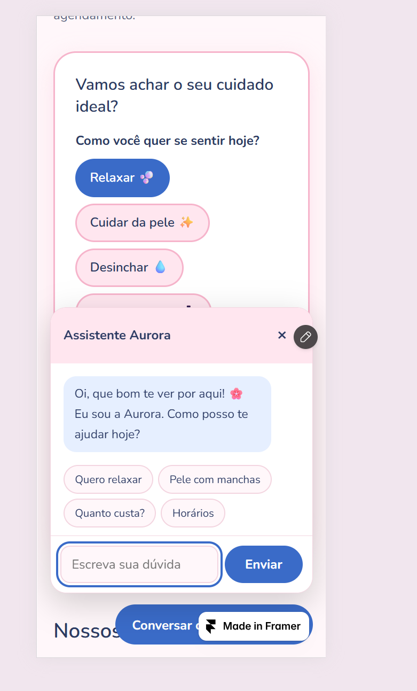

### Aurora respondendo com IA

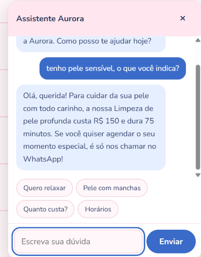

### Mensagem pronta no WhatsApp

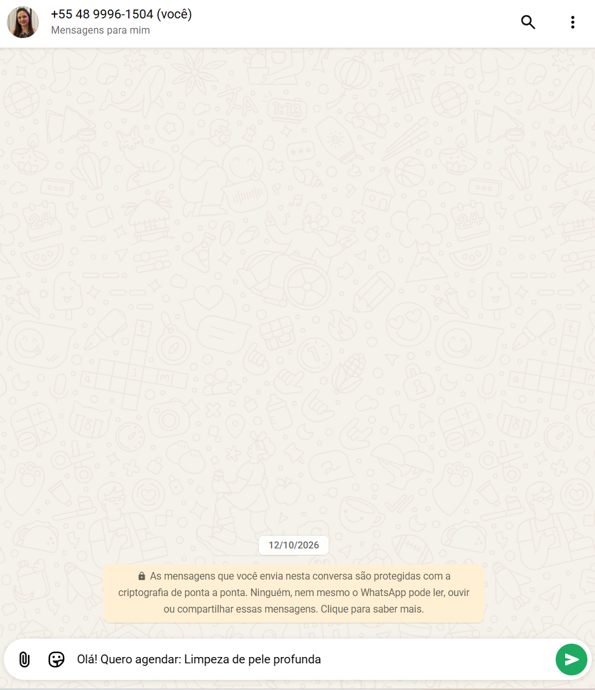

### Cenário do Make (Webhook → Google Gemini AI → Webhook response)

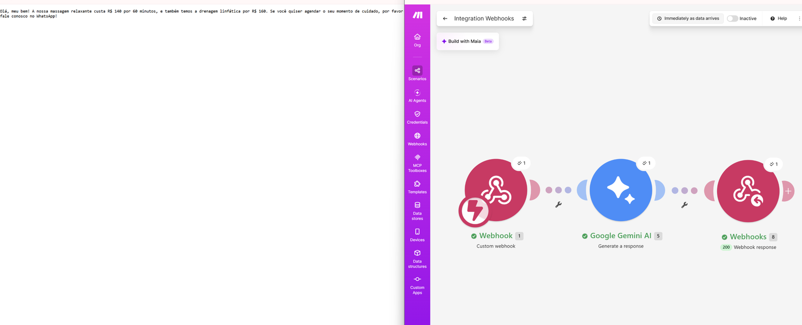

### Framer: Desktop, Tablet e Phone

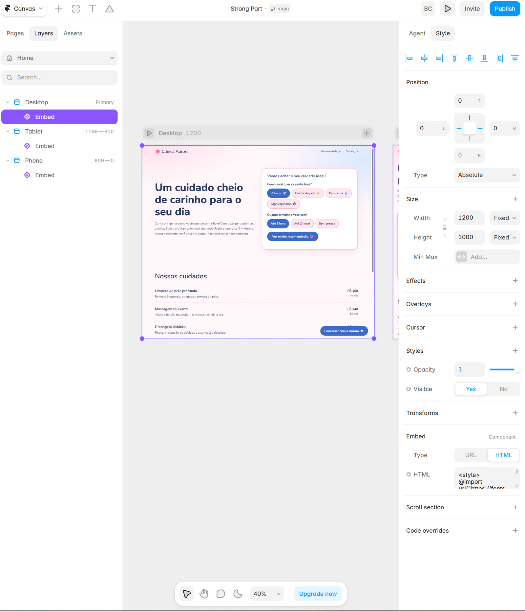 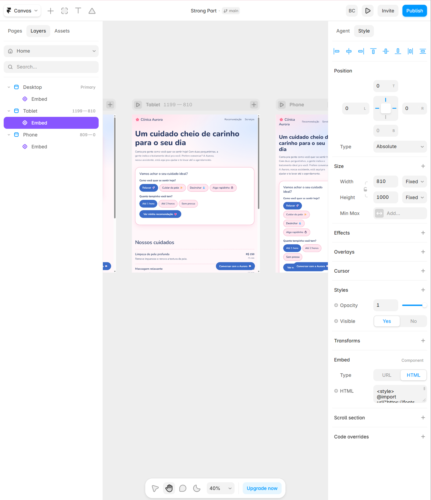 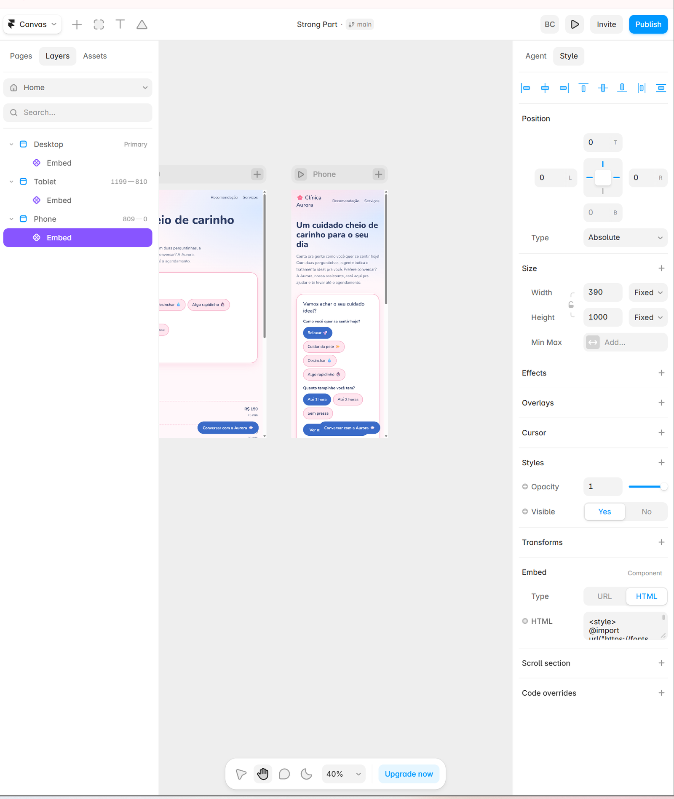

## ⚠️ Limitações

- O Embed do Framer tem altura fixa por breakpoint, o que cria rolagem interna.
- O mesmo código é colado em três Embeds (um por breakpoint).
- O plano gratuito do Framer exibe a marca "Made in Framer".
- A URL do webhook é pública no código; em produção seria preciso um intermediário com autenticação e limite de uso.
- A IA depende de Make e Gemini (cota gratuita) e leva alguns segundos para responder.
- O assistente não guarda memória da conversa.
- Dados da clínica (serviços, preços, horários, endereço) são fictícios e fixos no código.

## 📁 Estrutura do repositório

```
clinica-aurora/
├── index.html   # estrutura da página
├── style.css    # estilos
├── script.js    # recomendador, catálogo e assistente
├── prints/      # evidências da aplicação funcionando
└── README.md
```

> A versão publicada no Framer usa o mesmo código reunido em um único bloco HTML, com o CSS escopado em `#app`.

## 👩‍💻 Autoria

Criado por **Bruna Campos**. Cliente e dados fictícios, para fins acadêmicos e de portfólio.